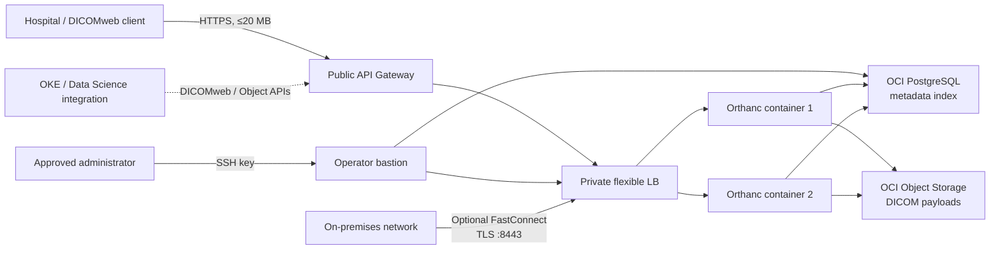

# Cloud-Native DICOM Store on OCI

This repository is a complete Terraform deployment of the core store in
Oracle's [cloud-native DICOM reference architecture](https://docs.oracle.com/en/solutions/cloud-native-dicom-on-oci/index.html):

- Orthanc DICOMweb and REST APIs on private OCI Container Instances
- OCI Database with PostgreSQL for the Orthanc metadata index
- private, versioned OCI Object Storage for DICOM payloads
- a private flexible load balancer across multiple Orthanc replicas
- a public HTTPS OCI API Gateway facade with CIDR filtering and rate limiting
- regional VCN, private application/database tiers, NSGs, NAT, and service gateway
- an SSH-key-only Oracle Linux bastion on a dedicated management subnet
- Ansible provisioning of operator diagnostics, OCI CLI, and database tools
- optional FastConnect private peering with DRG/BGP routing and TLS large-file ingest
- dedicated least-privilege storage identity and OCI Customer Secret Key
- API access/execution logs and optional OCI Monitoring alarms
- automated deploy, verification, Resource Manager packaging, and teardown

The design follows Oracle's recommendation to use regional subnets and NSGs.
The deployment uses Container Instances rather than OKE for the store because
Orthanc is the only defined application workload in the reference solution.
OKE inference/training workloads, FastConnect circuits, and Roving Edge devices
are environment-specific integration points; no model, circuit, CPE, or physical
device configuration is specified by the reference.

## Architecture



All application and database VNICs are private. API Gateway terminates public
TLS; traffic from the gateway to the private load balancer stays inside the VCN.
Orthanc disables traditional DICOM SCP port 4242 and exposes DICOMweb instead,
matching the reference architecture's API Gateway flow.

## Prerequisites

- Terraform 1.6 or newer
- Ansible Core 2.17 or newer for automatic bastion configuration
- OCI CLI configured with an API-key or security-token profile when
  `create_storage_identity = true`, or execution through an instance/resource
  principal
- a tenancy OCID, target compartment OCID, workload region, and tenancy home region
- sufficient OCI service limits for API Gateway, flexible Load Balancer,
  Container Instances, and OCI Database with PostgreSQL
- tenancy IAM privileges if `create_storage_identity = true`

Read [IAM prerequisites](docs/iam.md) before applying. The local `~/.oci/config`
is read through the selected profile; key material is never copied into this
repository.

## Deploy

The primary workflows are available through the repository Makefile:

```bash
make help
make validate
make plan
make apply
make get-credentials
make verify
make destroy
```

`make apply` and the bastion targets default to `~/.ssh/id_rsa`. Override the
key with `PRIVATE_KEY=/absolute/path/to/private_key`. Pass extra Terraform
planning arguments with `TF_ARGS`, for example
`make plan TF_ARGS="-var=orthanc_replicas=2"`.

1. Create the input file:

   ```bash
   cp terraform.tfvars.example terraform.tfvars
   ```

2. Set the four OCI placement values, `ssh_public_key_path`, a unique
   `storage_identity_email`, and replace `allowed_client_cidrs` with the
   hospital, VPN, or corporate egress CIDRs.
   Set `bastion_allowed_ssh_cidrs` separately if administrators use different
   egress addresses. Never use `0.0.0.0/0` for production SSH.
   The deployment preflight queries OCI IAM and stops before apply if the
   storage identity email is already assigned.

3. Validate and review a plan:

   ```bash
   scripts/validate.sh
   scripts/deploy.sh --plan-only
   terraform show dicom.tfplan
   ```

4. Apply:

   ```bash
   export BASTION_SSH_PRIVATE_KEY_FILE=/absolute/path/to/id_rsa
   scripts/deploy.sh
   ```

   For a controlled CI runner:

   ```bash
   scripts/deploy.sh --auto-approve
   ```

Provisioning managed PostgreSQL commonly takes tens of minutes. The script is
idempotent: after a partial service failure, correct the service-limit, capacity,
or policy issue and run it again. When `BASTION_SSH_PRIVATE_KEY_FILE` is set,
the deployment finishes by running Ansible against the new bastion. Without it,
Terraform still creates the VM and prints the separate configuration command.

## Bastion access

Connect after deployment and Ansible configuration:

```bash
scripts/ssh-bastion.sh
sudo dicom-status
sudo dicom-env
sudo dicom-psql
```

`dicom-status` tests Orthanc `/system`, a private DICOMweb QIDO-RS request, and
the managed PostgreSQL port. `dicom-env` shows non-secret endpoints, while
`dicom-psql` opens the TLS-protected metadata database. Ansible stores runtime
credentials in `/etc/oci-dicom/stack.json`, owned by root with mode `0600`.
The bastion has no OCI API key copied to it; configure a short-lived OCI CLI
session there only if your operating policy requires control-plane commands.

To rerun the idempotent configuration:

```bash
scripts/configure-bastion.sh --private-key /absolute/path/to/id_rsa
```

## Verify

Run the control-plane and API checks:

```bash
scripts/verify.sh
```

Optionally upload one synthetic, non-production DICOM instance:

```bash
scripts/verify.sh --dicom /absolute/path/to/test.dcm
```

Retrieve credentials only when needed:

```bash
terraform output -raw orthanc_username
terraform output -raw orthanc_password
```

The verifier stores credentials in a mode-0600 temporary netrc file, removes it
on exit, checks Orthanc `/system`, and runs a DICOMweb QIDO-RS query.

## Important 20 MB API Gateway limit

OCI API Gateway has a fixed
[20 MB maximum request body](https://docs.oracle.com/en-us/iaas/Content/APIGateway/Reference/apigatewaylimits.htm).
Many CT, MR, and whole-slide instances exceed it. The public endpoint is
therefore suitable for query/retrieve and smaller STOW-RS requests, but it is
not a universal bulk-ingest path.

For larger studies, connect the on-premises network to the private VCN with
FastConnect. Setting `enable_fastconnect = true` creates a DRG, VCN attachment,
on-premises routes, a private partner virtual circuit, and a TLS listener on
port 8443. This is an alternate path around API Gateway; it does not change
the gateway's limit.

The carrier circuit, provider activation key, and on-premises BGP router cannot
be ordered or configured by OCI Terraform. See
[FastConnect setup](docs/fastconnect.md) for the required inputs, activation
sequence, secure endpoint, and redundancy guidance. Do not make the private
load balancer public merely to bypass the limit.

## Security and state

- The bucket is private, encrypted at rest by Object Storage, and versioned by default.
- PostgreSQL uses regional durable storage and daily backups.
- Orthanc-to-PostgreSQL uses TLS; public clients use API Gateway HTTPS.
- NSGs permit only the documented tier-to-tier flows.
- SSH reaches only the bastion, only from approved administrator CIDRs, using
  public-key authentication; the bastion can reach only Orthanc, PostgreSQL,
  DNS, and outbound HTTPS.
- Orthanc basic authentication is enabled with a generated 32-character password.
- API access and execution logs are enabled. Pass
  `alarm_notification_topic_id` to activate backend-health and API-5xx alarms.
- DICOM and patient identifiers must not be placed in resource names, tags, or logs.
- FastConnect private ingest uses a Terraform-generated TLS certificate; its
  private key is protected in Terraform state and only its public certificate
  is distributed to clients.

Orthanc's S3 plugin requires an access/secret pair; it cannot sign OCI requests
with a Container Instances resource principal. The dedicated Customer Secret
Key, database password, and Orthanc password therefore exist in Terraform state.
Use encrypted remote state with strict operator access. OCI Resource Manager is
the recommended production runner:

```bash
scripts/package-resource-manager.sh
```

The packager reads `~/.ssh/id_rsa.pub` by default and embeds only that public
key as `bastion.pub`, with an automatic path override for the Resource Manager
runner. To select another public key:

```bash
scripts/package-resource-manager.sh output.zip /absolute/path/to/key.pub
```

No private SSH key is included.

If the deployment principal cannot manage tenancy IAM, set
`create_storage_identity = false` and supply an existing Customer Secret Key
pair through sensitive Resource Manager variables or `TF_VAR_*` environment
variables. Do not commit them to `terraform.tfvars`.

## Operations

See [operations.md](docs/operations.md) for scaling, credential rotation,
backup/recovery, monitoring, upgrades, and cleanup.

Useful outputs:

```bash
terraform output deployment_summary
terraform output resource_ocids
```

To review and destroy the stack:

```bash
scripts/destroy.sh
```

OCI refuses to delete a non-empty Object Storage bucket. This prevents a normal
destroy from silently erasing medical images; remove current and versioned
objects only under an approved retention/decommission process.

## Reference implementation notes

The Oracle solution page is an architecture, not a downloadable implementation:
its ZIP contains only the diagram. This repository makes the core architecture
concrete using the current OCI Terraform provider. Orthanc's official
[PostgreSQL plugin](https://orthanc.uclouvain.be/book/plugins/postgresql.html)
stores the index, while the official
[cloud object storage plugin](https://orthanc.uclouvain.be/book/plugins/object-storage.html)
uses OCI's
[S3-compatible Object Storage API](https://docs.oracle.com/en-us/iaas/Content/Object/Tasks/s3compatibleapi.htm)
for payloads.
