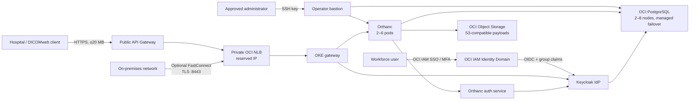

# Cloud-Native DICOM Store on OCI

This repository is a complete Terraform deployment of the core store in
Oracle's [cloud-native DICOM reference architecture](https://docs.oracle.com/en/solutions/cloud-native-dicom-on-oci/index.html):

- two or more Orthanc DICOMweb/REST instances on private OCI Kubernetes Engine (OKE)
- integrated Stone and OHIF Web viewers using the same study-scoped authorization
- Keycloak plus the official Orthanc authorization service
- optional OCI IAM Identity Domains SSO for existing workforce accounts
- platform-wide roles plus study-label-enforced viewer, uploader, editor, and
  administrator roles for every configured tenant
- OCI Database with PostgreSQL using a primary plus at least one replica node
  for the Orthanc metadata index
- private, versioned OCI Object Storage accessed through its S3-compatible API
- an OKE-managed private Network Load Balancer with a reserved private address
- a public HTTPS OCI API Gateway facade with CIDR filtering and rate limiting
- regional VCN, private application/database tiers, NSGs, NAT, and service gateway
- an SSH-key-only Oracle Linux bastion on a dedicated management subnet
- Ansible provisioning of operator diagnostics, OCI CLI, and database tools
- optional FastConnect private peering with DRG/BGP routing and TLS large-file ingest
- dedicated least-privilege storage identity and OCI Customer Secret Key
- API access/execution logs and optional OCI Monitoring alarms
- automated deploy, verification, Resource Manager packaging, and teardown

The design follows Oracle's recommendation to use regional subnets and NSGs.
OKE uses an enhanced private control plane and VCN-native pod networking.
FastConnect circuits and Roving Edge devices remain environment-specific
integration points; no carrier circuit, CPE, or physical device configuration
can be inferred from the reference architecture.

## Architecture



All application and database VNICs are private. API Gateway terminates public
TLS; traffic from the gateway to the private NLB stays inside the VCN.
Orthanc disables traditional DICOM SCP port 4242 and exposes DICOMweb instead,
matching the reference architecture's API Gateway flow.

## Prerequisites

- Terraform 1.6 or newer
- Ansible Core 2.17 or newer for automatic bastion configuration
- `jq`, `kubectl`, Ruby (standard YAML parser), `zip`, and `unzip` for the
  complete static/package validation suite
- curl with AWS Signature Version 4 support (`curl --aws-sigv4`)
- OCI credentials configured for Terraform to inspect the selected existing
  storage user and manage its stack-specific Customer Secret Key
- a tenancy OCID, target compartment OCID, workload region, and tenancy home region
- sufficient OCI service limits for API Gateway, OKE enhanced clusters, Compute
  worker nodes, Network Load Balancer, and OCI Database with PostgreSQL
- tenancy IAM privileges for the bastion dynamic group and OKE service policy,
  plus user, group, membership, policy, and Customer Secret Key privileges when
  `create_storage_customer_secret_key = true`, and Identity Domains
  application/group/grant privileges when OCI SSO is enabled

Read [IAM prerequisites](docs/iam.md) before applying. The local `~/.oci/config`
is read through the selected profile; key material is never copied into this
repository.

The Terraform root module, provider lock file, input file, saved plan, and local
state are contained in `terraform/`. Run the supported workflows from the
repository root through `make` or `scripts/`; they select that directory
automatically.

## Deploy

The primary workflows are available through the repository Makefile:

```bash
make help
make validate
make plan
make apply
make get-credentials
make verify
make verify-compliance
make failure-test
make restore-drill
make destroy
```

`make apply` and the bastion targets default to `~/.ssh/id_rsa`. Override the
key with `PRIVATE_KEY=/absolute/path/to/private_key`. Pass extra Terraform
planning arguments with `TF_ARGS`, for example
`make plan TF_ARGS="-var=orthanc_replicas=3 -var=postgres_instances=3"`.

1. Create the input file:

   ```bash
   cp terraform/terraform.tfvars.example terraform/terraform.tfvars
   ```

2. Set the four OCI placement values, `ssh_public_key_path`, the email of an
   existing OCI IAM user in `storage_user_email`, and replace
   `allowed_client_cidrs` with the
   hospital, VPN, or corporate egress CIDRs.
   Every regional workload resource, the Object Storage bucket, and the
   bucket-scoped runtime policy use `compartment_id`. Orthanc can access the
   native OCI-created bucket through OCI's S3-compatible path-style endpoint,
   so the stack does not modify the tenancy-wide default S3 compartment.
   Set `bastion_allowed_ssh_cidrs` separately if administrators use different
   egress addresses. Never use `0.0.0.0/0` for production SSH.
   Terraform requires the email to resolve to exactly one existing OCI IAM
   user and never creates, updates, or deletes that user. Destroy removes only
   the stack's Customer Secret Key, group membership, group, and bucket policy;
   the selected user and any unrelated credentials remain intact.
   After apply, automation sends a signed, read-only list request to the target
   bucket and waits up to 20 minutes for OCI's regional credential and IAM
   propagation before deploying the credential to Orthanc. Override this only
   when necessary with `STORAGE_CREDENTIAL_TIMEOUT_SECONDS`.
   To use existing OCI accounts for Orthanc, set `oci_identity_domain_sso` to
   the domain OCID that owns those users. See [OCI IAM SSO](docs/sso.md).
   Replace the example `orthanc_tenants` map with the approved tenant catalog.
   Labels are security identifiers and must remain stable after studies are
   classified. Enable `enable_tenant_test_users` only for acceptance testing.

3. Validate and review a plan:

   ```bash
   make validate
   make plan
   make show-plan
   ```

4. Apply:

   ```bash
   export BASTION_SSH_PRIVATE_KEY_FILE=/absolute/path/to/id_rsa
   scripts/deploy.sh
   ```

   For a controlled CI runner:

   ```bash
   scripts/deploy.sh --auto-approve
   ```

Provisioning managed PostgreSQL and OKE commonly takes tens of minutes. The script is
idempotent: after a partial service failure, correct the service-limit, capacity,
or policy issue and run it again. When `BASTION_SSH_PRIVATE_KEY_FILE` is set,
the deployment finishes by configuring the bastion, generating an
instance-principal kubeconfig, applying the Orthanc/Keycloak workloads, and
waiting for the private NLB. Without it, Terraform creates the infrastructure
and prints the two commands required to finish workload deployment.

## Bastion access

Connect after deployment and Ansible configuration:

```bash
scripts/ssh-bastion.sh
sudo /usr/local/sbin/dicom-status
sudo /usr/local/sbin/dicom-env
sudo /usr/local/sbin/dicom-psql
kubectl get pods -A
```

`dicom-status` tests Orthanc `/system`, a private DICOMweb QIDO-RS request, and
the managed PostgreSQL port. `dicom-env` shows non-secret endpoints, while
`dicom-psql` opens the TLS-protected metadata database. Ansible stores runtime
credentials in `/etc/oci-dicom/stack.json`, owned by root with mode `0600`.
The bastion has no OCI API key copied to it. Its exact instance OCID is the only
member of a Terraform-managed dynamic group allowed to use this OKE cluster.
SSH uses persistent trust-on-first-use state in
`~/.ssh/oci-dicom-known-hosts`, keyed by the bastion instance OCID. A changed
host key for the same instance is rejected. A replacement instance gets a new
alias and is enrolled on its first connection.

To rerun the idempotent configuration:

```bash
scripts/configure-bastion.sh --private-key /absolute/path/to/id_rsa
scripts/deploy-oke.sh --private-key /absolute/path/to/id_rsa
```

## Verify

Run the control-plane and API checks:

```bash
scripts/verify.sh
```

Generate and upload a synthetic, non-production DICOM instance that remains
visible in the Orthanc Web UI:

```bash
make verify-dicom
```

For an automated upload test that removes its synthetic instance afterward:

```bash
make verify-dicom-clean
```

To upload a DICOM file you supply instead:

```bash
make verify-dicom DICOM_FILE=/absolute/path/to/test.dcm
```

Retrieve credentials only when needed:

```bash
make get-credentials
```

The verifier exchanges the generated initial administrator credential for a
short-lived Keycloak access token, checks Orthanc `/system`, runs a DICOMweb
QIDO-RS query, and verifies that both Stone and OHIF are reachable. Generated
DICOM files contain no patient data. Samples uploaded with `make verify-dicom`
remain in Orthanc until deleted from the Web UI; `make verify-dicom-clean`
removes its sample automatically.

Run the complete synthetic acceptance suite while
`enable_tenant_test_users = true`:

```bash
make verify-compliance
make failure-test PRIVATE_KEY=~/.ssh/id_rsa
make restore-drill PRIVATE_KEY=~/.ssh/id_rsa
```

`verify-compliance` proves STOW-RS, QIDO-RS, WADO-RS, unlabeled quarantine,
positive tenant access, cross-tenant denial, study-scoped viewer tokens used by
Stone and OHIF, PostgreSQL-backed Orthanc audit events, private/versioned Object
Storage use, encryption-key mode, regional database durability, and the backup
policy. `failure-test` removes one Orthanc
pod and proves QIDO-RS remains available while Kubernetes replaces it.
`restore-drill` is a long-running and temporarily billable test: it creates a
manual managed-PostgreSQL backup, provisions a one-node database from that
backup, validates restored application tables through the bastion, and removes
both drill resources even on failure.

All repository-generated test objects use `SYNTHETIC-*` identifiers and contain
no patient data. Never run these targets with production DICOM input.

## Tenant authorization and quarantine

Each configured tenant has four Keycloak realm roles and, when OCI SSO is
enabled, four matching OCI Identity Domains groups. The official Orthanc
authorization service returns a single tenant label as `authorized-labels`.
Orthanc's authorization plugin enforces that label at study level for REST and
DICOMweb access. Platform-wide roles are privileged cross-tenant roles;
`orthanc-admin` is the trusted classifier and break-glass account.

Uploads deliberately enter an unlabeled quarantine. An uploader-controlled
DICOM tag is not accepted as an authorization decision. A trusted workflow
must assign exactly one configured label:

```bash
make classify-study TENANT=hospital-a STUDY_UID=2.25.1234
```

The classifier removes any other configured tenant label before applying the
selected one and verifies the one-label invariant. Until that succeeds, tenant
users cannot discover or retrieve the study.

## Important 20 MB API Gateway limit

OCI API Gateway has a fixed
[20 MB maximum request body](https://docs.oracle.com/en-us/iaas/Content/APIGateway/Reference/apigatewaylimits.htm).
Many CT, MR, and whole-slide instances exceed it. The public endpoint is
therefore suitable for query/retrieve and smaller STOW-RS requests, but it is
not a universal bulk-ingest path.

For larger studies, connect the on-premises network to the private VCN with
FastConnect. Setting `enable_fastconnect = true` creates a DRG, VCN attachment,
on-premises routes, a private partner virtual circuit, and a TLS listener on
port 8443 on the private OKE NLB. This is an alternate path around API Gateway; it does not change
the gateway's limit.

The carrier circuit, provider activation key, and on-premises BGP router cannot
be ordered or configured by OCI Terraform. See
[FastConnect setup](docs/fastconnect.md) for the required inputs, activation
sequence, secure endpoint, and redundancy guidance. Do not make the private
NLB public merely to bypass the limit.

## Security and state

- The bucket is private, encrypted at rest by Object Storage, and versioned by default.
- PostgreSQL uses at least two nodes, regional durable storage, automatic
  replica promotion on node failure, and daily backups.
- Orthanc-to-PostgreSQL uses TLS; public clients use API Gateway HTTPS.
- NSGs permit only the documented tier-to-tier flows.
- Calico runs in Oracle's VCN-native policy-only mode. Namespace default-deny
  policies then admit only DNS, the documented pod-to-pod flows, PostgreSQL,
  S3/OCI SSO HTTPS, health probes, and approved gateway/FastConnect CIDRs.
- Application pods do not mount Kubernetes API tokens. They use the runtime
  default seccomp profile, drop Linux capabilities, and run as non-root;
  Orthanc runs at least two pods on distinct workers, while Keycloak and its
  authorization tier each have two topology-spread replicas.
- SSH reaches only the bastion, only from approved administrator CIDRs, using
  public-key authentication; the bastion can reach only Orthanc, PostgreSQL,
  DNS, and outbound HTTPS.
- Keycloak handles OIDC authentication; Orthanc delegates access decisions to
  the official authorization service.
- When enabled, OCI IAM Identity Domains authenticates existing users and
  Keycloak maps OCI role-group claims into Orthanc roles. No SSO user is
  created by Terraform.
- Realm roles include privileged platform-wide profiles and tenant-specific
  profiles whose study access is restricted by Orthanc labels. The generated
  initial user is the global break-glass administrator.
- Use `make get-credentials` for the break-glass user, Keycloak bootstrap
  admin, OCI SSO URL, and generated role-group names. Assign existing users to
  the minimum OCI IAM group required for their work.
- API access and execution logs are enabled. Pass
  `alarm_notification_topic_id` to activate backend-health and API-5xx alarms.
- DICOM and patient identifiers must not be placed in resource names, tags, or logs.
- FastConnect private ingest uses a Terraform-generated TLS certificate; its
  private key is protected in Terraform state and only its public certificate
  is distributed to clients.

Orthanc's S3 plugin requires an access/secret pair; it cannot sign the S3
compatibility protocol with OKE workload identity. Terraform creates only a
stack-specific Customer Secret Key on the existing user selected by
`storage_user_email`; it never manages that user. The Customer Secret Key,
database passwords, Keycloak secrets, and initial user password therefore exist
in Terraform state. OCI can report a new key as `ACTIVE` before the regional
Object Storage data plane accepts it, so the deployment's signed S3 readiness
gate is intentional and must not be bypassed during credential rotation.
Use encrypted remote state with strict operator access. OCI Resource Manager is
the recommended production runner:

```bash
scripts/package-resource-manager.sh
```

The Resource Manager package contains the complete root module, including OCI
SSO/custom-claim automation, creates infrastructure, and emits the sensitive
OKE manifest as an output. Apply that output from the configured bastion with
`scripts/deploy-oke.sh`. The packager reads `~/.ssh/id_rsa.pub` by default and embeds only that public
key as `bastion.pub`, with an automatic path override for the Resource Manager
runner. To select another public key:

```bash
scripts/package-resource-manager.sh output.zip /absolute/path/to/key.pub
```

No private SSH key is included.

If the deployment principal cannot manage tenancy IAM, set
`create_storage_customer_secret_key = false` and supply an existing Customer
Secret Key pair through sensitive Resource Manager variables or `TF_VAR_*`
environment variables. Do not commit them to `terraform/terraform.tfvars`.

The storage choice, alternatives, consistency boundary, and recovery
implications are recorded in
[the storage-plugin assessment](docs/storage-plugin-assessment.md). The public
edge choice and OCI WAF limitation are recorded in
[the edge-security assessment](docs/edge-security.md).

## Operations

See [operations.md](docs/operations.md) for scaling, credential rotation,
backup/recovery, monitoring, upgrades, and cleanup.

Useful outputs:

```bash
make outputs
terraform -chdir=terraform output resource_ocids
```

To review and destroy the stack while preserving the Object Storage safeguard:

```bash
make destroy
```

OCI refuses to delete a non-empty Object Storage bucket, so `make destroy`
cannot silently erase medical images. After an approved retention and
decommission process, `make destroy-purge` requires the exact bucket name and
then permanently removes the bucket, all current and versioned objects,
pre-authenticated requests, replication policies, and uncommitted multipart
uploads before destroying the rest of the stack. The non-interactive
`make destroy-purge-auto` target is intended only for controlled automation.
The destroy path does not require SSH access to the bastion or perform a
separate Kubernetes namespace deletion. It revokes OCI Identity Domains grants
while their application is active, then deactivates the application because
OCI refuses both grant revocation from an inactive app and deletion of an
active app. It next tears down OKE, removes the exact Kubernetes-managed NLB
that owns the reserved gateway address, and lets Terraform delete the remaining
resources. This ordering is retry-safe after a partially completed destroy.
Terraform init, destroy planning, targeted cleanup, and final destruction retry
only recognized transient OCI DNS-resolution failures. The defaults are six
attempts with an increasing delay; controlled automation can override them with
`TERRAFORM_NETWORK_RETRY_ATTEMPTS` and
`TERRAFORM_NETWORK_RETRY_DELAY_SECONDS`. Configuration, permission, quota, and
service errors fail immediately and remain visible.

## Reference implementation notes

The Oracle solution page is an architecture, not a downloadable implementation:
its ZIP contains only the diagram. This repository makes the core architecture
concrete using the current OCI Terraform provider. Orthanc's official
[PostgreSQL plugin](https://orthanc.uclouvain.be/book/plugins/postgresql.html)
stores the index, while the official
[cloud object storage plugin](https://orthanc.uclouvain.be/book/plugins/object-storage.html)
uses OCI's
[S3-compatible Object Storage API](https://docs.oracle.com/en-us/iaas/Content/Object/Tasks/s3compatibleapi.htm)
for payloads. The database node topology follows OCI's
[PostgreSQL high-availability guidance](https://docs.oracle.com/en-us/iaas/Content/postgresql/high-availability.htm).
