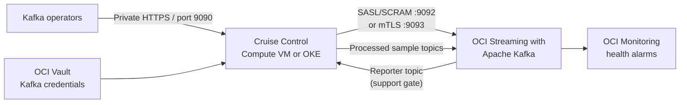

# Cruise Control with OCI Streaming with Apache Kafka

This guide describes how to assess, install, configure, and safely introduce
LinkedIn Cruise Control alongside an existing OCI Streaming with Apache Kafka
cluster (also called OCI Managed Kafka).

Last reviewed: 2026-07-28.

## Important compatibility decision

Do not install Cruise Control in production until Oracle confirms that the
managed cluster exposes a compatible Cruise Control metrics stream to customer
clients.

The standard upstream deployment is not directly customer-installable on OCI
Managed Kafka:

- Cruise Control's default sampler requires
  `CruiseControlMetricsReporter` to run inside every Kafka broker. Upstream
  installation requires copying its JAR into each broker and changing
  `metric.reporters`.
- OCI manages the broker operating systems and does not provide customer access
  to install broker JARs.
- OCI lists `cruise.control.metrics.reporter.bootstrap.*` and
  `cruise.control.metrics.topic` as non-configurable broker properties.
- OCI Monitoring publishes useful broker-level metrics, but Cruise Control also
  needs partition-level workload data to construct its model. The OCI metrics
  catalog is therefore not a drop-in source for Cruise Control's default
  Prometheus sampler.
- OCI broker logs are not available to customers, which limits troubleshooting
  of a broker-side reporter.
- The only currently documented OCI Managed Kafka add-on is public
  connectivity; Cruise Control is not a customer-installable add-on.

The reserved Cruise Control properties suggest that OCI may use related
components internally, but the public documentation does not promise that the
`__CruiseControlMetrics` topic is visible, customer-readable, or compatible
with an external Cruise Control server. Treat those capabilities as unsupported
until Oracle confirms them for the specific cluster.

Use this decision table:

| Result | Action |
| --- | --- |
| Oracle confirms a compatible reporter topic is readable and external replica reassignment is supported | Continue with this guide, initially in proposal-only mode |
| The reporter topic is absent, empty, inaccessible, or incompatible | Stop; Cruise Control cannot build a safe workload model |
| Only OCI Monitoring metrics are available | Use OCI Monitoring and alarms; do not enable Cruise Control execution |
| A future OCI-supported Cruise Control add-on becomes available | Prefer the managed add-on over this client-side installation |

## Target architecture

Cruise Control runs as a client application. It is not installed on the managed
brokers.



Place Cruise Control in a private subnet in a VCN that can resolve and reach
the Kafka broker endpoints. Do not expose its REST API directly to the
internet: POST endpoints can initiate cluster-wide partition movement.

## Phase 1: collect the existing cluster details

Record these values before making changes:

| Input | Value |
| --- | --- |
| OCI region | `<region>` |
| Kafka cluster OCID | `<kafka-cluster-ocid>` |
| Kafka version | `<3.9.1-or-4.0.0>` |
| Coordination mode | `<ZooKeeper-or-KRaft>` |
| Cluster type | `<development-or-production>` |
| Broker count | `<count>` |
| OCPUs per broker | `<count>` |
| Storage per broker in GB | `<size>` |
| SASL/SCRAM bootstrap servers | `<host:9092,...>` |
| mTLS bootstrap servers, if used | `<host:9093,...>` |
| Kafka authentication method | `<SASL/SCRAM-or-mTLS>` |
| Kafka principal | `<principal>` |
| Cruise Control subnet and NSG | `<subnet-and-nsg>` |

Get the current service-side details:

```bash
export KAFKA_CLUSTER_ID='<kafka-cluster-ocid>'
export OCI_REGION='<region>'

oci kafka cluster get \
  --kafka-cluster-id "${KAFKA_CLUSTER_ID}" \
  --region "${OCI_REGION}" \
  > kafka-cluster.json
```

Also save the current cluster configuration, broker count, shapes, storage,
client endpoints, and authentication settings from the OCI Console. Keep this
snapshot with the change record.

OCI currently supports Kafka 3.9.1 and 4.0.0. Kafka 3.7.0 reached OCI end of
life on 2026-05-30. Upgrade an end-of-life cluster before introducing another
control plane. Upstream Cruise Control requires Java 17; its compatibility
matrix requires at least the 2.5.143 line for Kafka 3.9 and 2.5.144 for Kafka
4.0. Pin a tested release rather than building from `main`; the examples below
use `2.5.146`.

## Phase 2: open an Oracle support request

Include the cluster OCID, region, Kafka version, and intended Cruise Control
version. Ask Oracle to answer all of the following:

1. Does this cluster run a Cruise Control metrics reporter?
2. What is the exact metrics topic name?
3. Is that topic supported for consumption by a customer-managed Cruise
   Control instance?
4. What reporter version and metric schema are in use?
5. Is the topic retained across broker replacement, scaling, patching, and
   Kafka upgrades?
6. Can customer principals receive `READ` and `DESCRIBE` access to that topic?
7. Are `AlterPartitionReassignments`, leader election, broker demotion, and
   replica movement through Kafka Admin APIs supported?
8. Could an external Cruise Control executor conflict with OCI's own broker
   recovery, scaling, or performance-management processes?
9. Are broker IDs and rack values stable and exposed through Kafka metadata?
10. What concurrency or throughput limits must be applied to reassignments?

Proceed only with written confirmation. Store the response in the production
change record.

## Phase 3: verify the reporter compatibility gate

Create a protected Kafka client properties file using the cluster's existing
authentication. For OCI SASL/SCRAM, OCI supports `SCRAM-SHA-512`:

```properties
security.protocol=SASL_SSL
sasl.mechanism=SCRAM-SHA-512
ssl.truststore.location=/etc/cruise-control/kafka.truststore.jks
ssl.truststore.password=<truststore-password>
sasl.jaas.config=org.apache.kafka.common.security.scram.ScramLoginModule required username="<username>" password="<password>";
```

Save it as `/etc/cruise-control/client.properties`, set ownership to the
Cruise Control service account, and set mode `0600`. Do not commit this file or
place the password in user data, shell history, an image, or a Kubernetes
ConfigMap. Retrieve credentials from OCI Vault at runtime.

For mTLS, follow OCI's client-certificate procedure and use the cluster's port
9093 endpoint. Keep the private key in OCI Vault or a Kubernetes Secret backed
by an approved secret-management process.

From a host in the intended Cruise Control subnet, verify:

```bash
export BOOTSTRAP_SERVERS='<broker-1:9092,broker-2:9092>'
export KAFKA_BIN='/opt/kafka/bin'
export CLIENT_CONFIG='/etc/cruise-control/client.properties'

"${KAFKA_BIN}/kafka-broker-api-versions.sh" \
  --bootstrap-server "${BOOTSTRAP_SERVERS}" \
  --command-config "${CLIENT_CONFIG}"

"${KAFKA_BIN}/kafka-topics.sh" \
  --bootstrap-server "${BOOTSTRAP_SERVERS}" \
  --command-config "${CLIENT_CONFIG}" \
  --list
```

Install the Apache Kafka client CLI that matches the managed cluster version if
the host does not already provide these commands. Installing client tools does
not install or start a Kafka broker.

Confirm the support-provided metrics topic exists. If Oracle confirms the
default name, test it without printing payloads:

```bash
timeout 30 "${KAFKA_BIN}/kafka-console-consumer.sh" \
  --bootstrap-server "${BOOTSTRAP_SERVERS}" \
  --consumer.config "${CLIENT_CONFIG}" \
  --topic __CruiseControlMetrics \
  --max-messages 1 \
  --property print.value=false
```

The gate passes only when a message is consumed and Oracle confirms that its
schema matches the selected Cruise Control version. Creating an empty topic
with the correct name does not pass the gate; metrics must be produced by every
broker.

## Phase 4: prepare networking and access

For a private OCI Managed Kafka cluster:

1. Deploy one Compute VM or an OKE workload in a private subnet.
2. Ensure VCN DNS resolves every hostname returned in Kafka metadata, not just
   the bootstrap hostname.
3. Allow stateful egress from Cruise Control to Kafka:
   - TCP 9092 for SASL/SCRAM, or
   - TCP 9093 for mTLS.
4. Allow HTTPS egress to OCI Vault and other required OCI services through a
   service gateway where supported, otherwise through a NAT gateway.
5. Allow inbound TCP 9090 only from the operator subnet, bastion, VPN, or an
   internal reverse proxy.
6. Deny public ingress to port 9090.
7. Synchronize time through the approved NTP source. Invalid clocks cause
   Cruise Control sampling-window failures.

Public connectivity for Kafka is not required when Cruise Control shares a
private network path with the cluster.

## Phase 5: define Kafka authorization

Use a dedicated principal. Cruise Control has two permission profiles:

- Proposal-only: metadata discovery, topic configuration reads, reporter-topic
  consumption, and read/write access to its own sample-store topics.
- Execution: proposal-only permissions plus cluster alteration and partition
  reassignment privileges.

At minimum, design ACLs for these capabilities:

| Resource | Proposal-only operations | Additional execution operations |
| --- | --- | --- |
| Cluster | `DESCRIBE`, `DESCRIBE_CONFIGS` | `ALTER` |
| Existing topics | `DESCRIBE`, `DESCRIBE_CONFIGS` | Only the topic alterations explicitly approved |
| Reporter topic | `READ`, `DESCRIBE` | None |
| Cruise Control sample topics | `CREATE`, `READ`, `WRITE`, `DESCRIBE`, `DESCRIBE_CONFIGS` | `ALTER`, if Cruise Control must repair their configuration |
| Cruise Control consumer groups | `READ`, `DESCRIBE` | None |

OCI Kafka ACLs are enforced by the Kafka authorizer. If
`allow.everyone.if.no.acl.found=false`, every required permission must be
explicit. Use the existing superuser only for the initial compatibility test,
then replace it with least privilege before production.

Use a consistent prefix for customer-owned resources:

```text
__KafkaCruiseControlPartitionMetricSamples
__KafkaCruiseControlModelTrainingSamples
cruise-control-
```

Do not change, delete, or recreate the service-owned reporter topic without
Oracle approval.

OCI's documented SASL/SCRAM workflow provisions a cluster superuser. If OCI
does not support an additional restricted SASL identity for the cluster, use a
dedicated mTLS client identity with ACLs or keep the pilot proposal-only under
the explicitly approved superuser. Do not represent a superuser credential as
least privilege.

OCI production clusters default `auto.create.topics.enable=false`. Cruise
Control can explicitly create its sample-store topics when its principal has
permission. If change policy requires pre-creation, create both sample topics
with:

- 32 partitions, matching the upstream default;
- replication factor `min(3, broker count)` for production;
- `cleanup.policy=delete`;
- a retention period long enough to cover the configured sampling history.

## Phase 6: install Cruise Control on Oracle Linux

The following reference installation uses an Oracle Linux Compute VM. For OKE,
put the same pinned build and configuration in an internally maintained image,
run one active replica, and use a PodDisruptionBudget.

Install build dependencies:

```bash
sudo dnf install -y git java-17-openjdk-devel jq
java -version
```

Create a non-login service account and directories:

```bash
sudo useradd \
  --system \
  --home-dir /opt/cruise-control \
  --shell /sbin/nologin \
  cruisecontrol

sudo mkdir -p \
  /etc/cruise-control \
  /var/log/cruise-control
```

Clone and build the pinned release:

```bash
sudo git clone \
  --depth 1 \
  --branch 2.5.146 \
  https://github.com/linkedin/cruise-control.git \
  /opt/cruise-control

sudo chown -R cruisecontrol:cruisecontrol \
  /opt/cruise-control \
  /var/log/cruise-control

sudo -u cruisecontrol \
  bash -lc 'cd /opt/cruise-control && ./gradlew jar copyDependantLibs'

sudo cp \
  /opt/cruise-control/config/cruisecontrol.properties \
  /etc/cruise-control/cruisecontrol.properties
```

Record the Git tag and commit SHA in the change record. Do not run an
unpinned container image or a mutable `latest` tag.

## Phase 7: configure Cruise Control

Start from the pinned release's complete `cruisecontrol.properties`; do not
replace it with only the small fragment below. Set or override these values:

```properties
bootstrap.servers=<broker-1:9092,broker-2:9092>
client.id=oci-cruise-control

security.protocol=SASL_SSL
sasl.mechanism=SCRAM-SHA-512
ssl.truststore.location=/etc/cruise-control/kafka.truststore.jks
ssl.truststore.password=<truststore-password>

metric.sampler.class=com.linkedin.kafka.cruisecontrol.monitor.sampling.CruiseControlMetricsReporterSampler
metric.reporter.topic=__CruiseControlMetrics

sample.store.class=com.linkedin.kafka.cruisecontrol.monitor.sampling.KafkaSampleStore
partition.metric.sample.store.topic=__KafkaCruiseControlPartitionMetricSamples
broker.metric.sample.store.topic=__KafkaCruiseControlModelTrainingSamples
sample.store.topic.replication.factor=3

capacity.config.file=/etc/cruise-control/capacity.json

self.healing.enabled=false
two.step.verification.enabled=true

num.concurrent.partition.movements.per.broker=1
max.num.cluster.partition.movements=10
num.concurrent.intra.broker.partition.movements=1
num.concurrent.leader.movements=25
default.replication.throttle=<approved-by-Oracle>

webserver.http.address=<private-vnic-ip>
webserver.http.port=9090
webserver.http.cors.enabled=false
webserver.security.enable=true
webserver.security.provider=com.linkedin.kafka.cruisecontrol.servlet.security.BasicSecurityProvider
webserver.auth.credentials.file=/etc/cruise-control/basic-auth.credentials
```

Notes:

- Replace the reporter topic with the exact Oracle-confirmed value.
- Set the sample topic replication factor no higher than the broker count.
- Keep self-healing disabled throughout the pilot and initial production
  observation period.
- Start with low movement concurrency and an Oracle-approved replication
  throttle. Upstream defaults are too aggressive for an unvalidated managed
  service integration.
- Do not request intra-broker optimization because OCI does not expose or
  document customer control of broker log directories. The concurrency value
  remains `1` because upstream Cruise Control validates it as a positive
  integer, but it is unused unless an intra-broker operation is requested.
- Put TLS on the Cruise Control API itself or terminate TLS at an internal
  reverse proxy. Basic authentication over plaintext is acceptable only across
  a tightly controlled localhost connection.

Keep Kafka credentials outside the properties file when possible. One option
for SASL is a root-owned JAAS file:

```text
KafkaClient {
  org.apache.kafka.common.security.scram.ScramLoginModule required
  username="<username>"
  password="<password>";
};
```

Save it as `/etc/cruise-control/kafka-client-jaas.conf`, mode `0600`, and pass:

```text
-Djava.security.auth.login.config=/etc/cruise-control/kafka-client-jaas.conf
```

through `KAFKA_OPTS`. Retrieve the values from OCI Vault during boot and rotate
them through a controlled restart.

### Capacity configuration

Cruise Control cannot infer broker capacity safely. Create
`/etc/cruise-control/capacity.json` using the actual OCI broker OCPUs, storage,
and an Oracle-approved network limit:

```json
{
  "brokerCapacities": [
    {
      "brokerId": "-1",
      "capacity": {
        "DISK": "<storage-per-broker-in-MB>",
        "CPU": {
          "num.cores": "<ocpus-per-broker>"
        },
        "NW_IN": "<approved-KB-per-second>",
        "NW_OUT": "<approved-KB-per-second>"
      },
      "doc": "Default capacity for the OCI Managed Kafka brokers"
    }
  ]
}
```

Do not guess the network values. Incorrect capacity values can produce unsafe
proposals even when the observed metrics are correct. Update this file and
restart Cruise Control whenever the OCI broker shape, OCPUs, storage, or broker
count changes.

### REST authentication

Create `/etc/cruise-control/basic-auth.credentials` using the Jetty credentials
format documented by Cruise Control:

```text
cc-viewer: <hashed-or-approved-secret>,VIEWER
cc-operator: <hashed-or-approved-secret>,USER
cc-admin: <hashed-or-approved-secret>,ADMIN
```

Restrict it to the service account:

```bash
sudo chown cruisecontrol:cruisecontrol \
  /etc/cruise-control/basic-auth.credentials
sudo chmod 600 \
  /etc/cruise-control/basic-auth.credentials \
  /etc/cruise-control/client.properties \
  /etc/cruise-control/kafka-client-jaas.conf
```

Use enterprise SSO or an authenticated internal proxy for a production
deployment when available.

## Phase 8: create the systemd service

Create `/etc/systemd/system/cruise-control.service`:

```ini
[Unit]
Description=Kafka Cruise Control
After=network-online.target
Wants=network-online.target

[Service]
Type=simple
User=cruisecontrol
Group=cruisecontrol
WorkingDirectory=/opt/cruise-control
Environment="JAVA_HOME=/usr/lib/jvm/java-17-openjdk"
Environment="KAFKA_OPTS=-Djava.security.auth.login.config=/etc/cruise-control/kafka-client-jaas.conf"
ExecStart=/opt/cruise-control/kafka-cruise-control-start.sh /etc/cruise-control/cruisecontrol.properties 9090
Restart=on-failure
RestartSec=10
TimeoutStopSec=60
NoNewPrivileges=true
PrivateTmp=true
ProtectHome=true
ProtectSystem=strict
ReadWritePaths=/var/log/cruise-control /opt/cruise-control/logs

[Install]
WantedBy=multi-user.target
```

Then start it:

```bash
sudo systemctl daemon-reload
sudo systemctl enable --now cruise-control
sudo systemctl status cruise-control
sudo journalctl -u cruise-control -f
```

If `/opt/cruise-control/logs` is not used by the selected release, remove it
from `ReadWritePaths`. If it is used, create it and assign it to the service
account before starting.

## Phase 9: validate in proposal-only mode

Wait at least 10 minutes for initial sampling. A low-traffic cluster can require
longer. Query state from an approved operator host:

```bash
export CC_URL='http://<private-cruise-control-ip>:9090'

curl --fail --silent --show-error \
  --user '<operator>:<password>' \
  "${CC_URL}/kafkacruisecontrol/state?json=true" \
  | jq .
```

The validation gate requires all of the following:

- every OCI broker appears;
- the executor is idle;
- partition and broker metric windows become valid;
- the monitored-partition percentage reaches the configured threshold;
- the reporter topic continues receiving data from every broker;
- there are no authentication, authorization, missing-metric, or capacity
  errors;
- OCI Monitoring shows zero offline and under-replicated partitions.

Generate a dry-run proposal:

```bash
curl --fail --silent --show-error \
  --user '<operator>:<password>' \
  "${CC_URL}/kafkacruisecontrol/rebalance?dryrun=true&json=true" \
  | jq .
```

Review:

- total data movement;
- number of replica and leader movements;
- rack-awareness changes;
- before/after CPU, disk, inbound network, and outbound network balance;
- excluded topics;
- whether the proposed moves stay within the approved change window and
  throughput budget.

Do not add `dryrun=false` during this phase.

## Phase 10: controlled execution

Enable execution only after the proposal-only soak period, Oracle confirmation,
and a reviewed change request.

1. Take a fresh dry-run proposal.
2. Confirm the Kafka cluster lifecycle is active and OCI alarms are clear.
3. Pause broker scaling, upgrades, and unrelated topic reassignment.
4. Record the current partition assignment.
5. Approve the two-step request through the Cruise Control workflow.
6. Execute a small, bounded proposal with the initial low concurrency.
7. Watch Cruise Control executor state and OCI metrics continuously.
8. Stop execution if under-replicated partitions, offline partitions, failed
   produce/fetch requests, or client latency increase beyond the approved
   limits.
9. Keep `self.healing.enabled=false` until separate production approval.

Never run two Cruise Control executors against the same Kafka cluster.

## Rollback and removal

Stopping Cruise Control does not automatically undo completed Kafka replica
movements.

To remove the client-side deployment:

```bash
sudo systemctl disable --now cruise-control
```

Then:

1. Revoke the Cruise Control principal's ACLs.
2. Remove or rotate its Vault credentials.
3. Preserve logs and the last partition assignment with the change record.
4. Delete only the two customer-owned sample-store topics after confirming no
   Cruise Control instance uses them.
5. Do not delete the Oracle-managed reporter topic.
6. Remove the VM, OKE workload, NSG rules, and secrets through the same
   infrastructure-management process that created them.

If an executed proposal must be reversed, use the recorded previous partition
assignment in an approved Kafka reassignment procedure. A process stop is not
a data-placement rollback.

## Troubleshooting

### `__CruiseControlMetrics` is missing or empty

Stop. Do not create an empty replacement and do not enable execution. Confirm
with Oracle that the reporter is enabled and customer access is supported.

### `NotEnoughValidWindowsException`

Common causes are a cold start, missing reporter data, an incompatible reporter
schema, blocked ACLs, or incorrect clocks. Wait for the sampling window, verify
that all brokers produce metrics, and check Cruise Control logs. On OCI Managed
Kafka, broker-side reporter failures require Oracle Support because broker logs
are unavailable.

### Metadata works but load and proposals do not

Kafka Admin API access alone is insufficient. Cruise Control can display basic
metadata without receiving the partition-level metrics required for a workload
model. Recheck the reporter gate.

### Authentication succeeds but topic creation fails

OCI production clusters default to disabled automatic topic creation. Grant
explicit `CREATE` permissions for the two customer-owned sample topics or
pre-create them using the approved administrator identity.

### Proposals show unrealistic capacity violations

Compare `capacity.json` with the current OCI broker shape, OCPUs, storage, and
network limits. Restart Cruise Control after correcting it and wait for new
valid windows before reviewing another proposal.

## OCI-native fallback

When the reporter gate cannot pass, use the managed-service controls instead:

- OCI Monitoring namespace `oci_kafka`;
- alarms for CPU, memory, available disk, offline partitions, under-replicated
  partitions, and failed produce/fetch requests;
- OCI cluster updates for broker count, OCPUs, broker shape, and storage;
- a reviewed Kafka Admin API reassignment process only where Oracle documents
  and supports it.

This fallback provides observability and controlled capacity changes without
introducing an unsupported external executor.

## References

- [OCI Streaming with Apache Kafka overview](https://docs.oracle.com/en-us/iaas/Content/kafka/overview.htm)
- [OCI supported Kafka versions](https://docs.oracle.com/en-us/iaas/Content/kafka/versions.htm)
- [OCI managed Kafka cluster configuration restrictions](https://docs.oracle.com/en-us/iaas/Content/kafka/config.htm)
- [OCI Kafka SASL/SCRAM configuration](https://docs.oracle.com/en-us/iaas/Content/kafka/security-sasl.htm)
- [OCI Kafka mTLS configuration](https://docs.oracle.com/en-us/iaas/Content/kafka/security-mtls.htm)
- [OCI Kafka ACL configuration](https://docs.oracle.com/en-us/iaas/Content/kafka/security-acl.htm)
- [OCI Kafka metrics](https://docs.oracle.com/en-us/iaas/Content/kafka/metrics.htm)
- [OCI Kafka logging limitations](https://docs.oracle.com/en-us/iaas/Content/kafka/logging.htm)
- [OCI Managed Kafka add-ons](https://docs.oracle.com/en-us/iaas/Content/kafka/addons-overview.htm)
- [Cruise Control README and compatibility matrix](https://github.com/linkedin/cruise-control/blob/main/README.md)
- [Cruise Control configuration reference](https://github.com/linkedin/cruise-control/wiki/Configurations)
- [Cruise Control security](https://github.com/linkedin/cruise-control/wiki/Security)
- [Cruise Control troubleshooting](https://github.com/linkedin/cruise-control/wiki/Troubleshooting)
